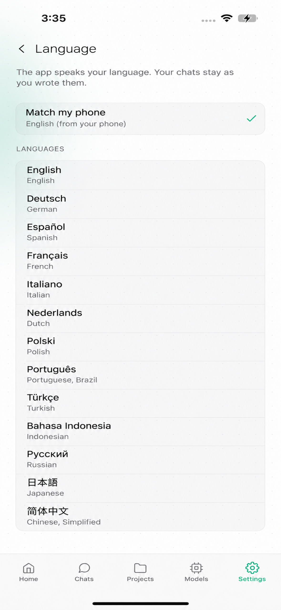
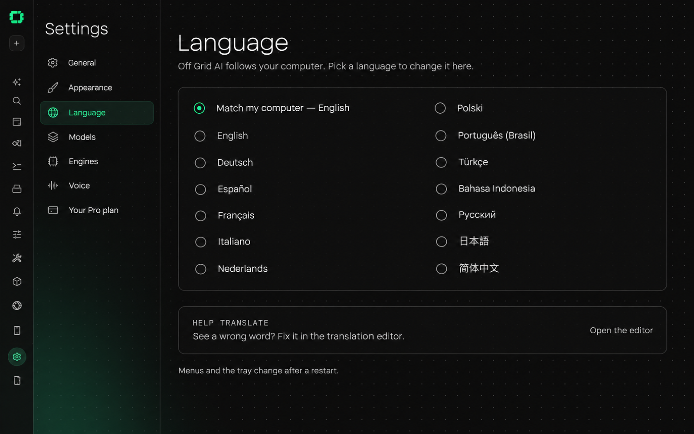
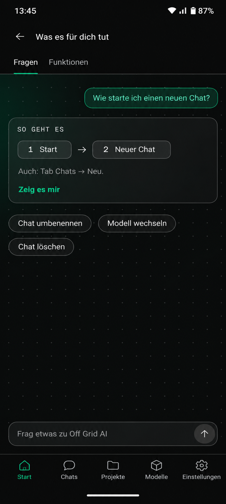
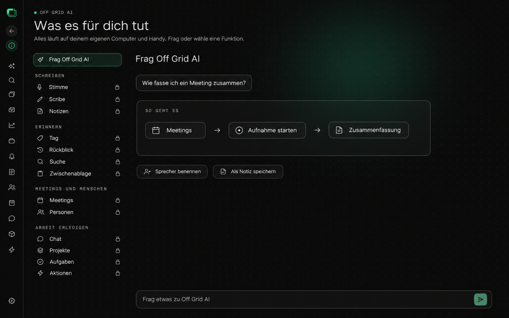

# App languages: plan

Status: plan only. Mac decided the 5 calls on 18 Nov (see "Decided calls"). No code changes until Mac says build.
Date: 18 Nov 2026.

## In short

- The apps get the same 12 languages as the website: pt-BR, es-419, id, de, fr, it, ja, zh-CN, ru, pl, tr, nl.
- One new shared package, `@offgrid/i18n`, holds all the logic. Mobile, desktop and the extension only plug it in.
- The website's method works in the apps. The English text is the key. A JSX runtime swaps text and readable props at render. Most screens need no changes.
- Text that is built in code (alerts, toasts, menus, notifications) uses `t()`. A static collect pass finds it.
- CI fails when a new English string has no translation. So new screens, such as the new onboarding, are born translatable.
- All 12 locales are built and turned on together, in one release (C1).
- Model replies follow the app language, with a toggle in Settings on both apps (C4).
- Size: about **5,200 unique strings, about 26,000 words** across the three apps and shared.

## What it looks like

| Mobile: Settings → Language | Desktop: Settings → Language |
|---|---|
|  |  |

| Mobile: the guide in German | Desktop: the guide in German |
|---|---|
|  |  |

These are concept images (made with codex). They are not screenshots of built screens. One line on the desktop image is wrong: it says menus change after a restart. The plan rebuilds menus and the tray at once (step 6).

## 1. Does the website's method work in the apps?

Yes, with two changes.

**Mobile (React Native 0.83, Hermes).** `@react-native/babel-preset` adds `@babel/plugin-transform-react-jsx` with `{ runtime: 'automatic' }` and no `importSource` option (`node_modules/@react-native/babel-preset/src/configs/main.js:69-74`). The preset has `useTransformReactJSXExperimental: true`, which turns that plugin off. Then `babel.config.js` adds the same plugin with `importSource: '@offgrid/i18n'`. The runtime swaps `<Text>` children and the props `title`, `accessibilityLabel`, `accessibilityHint`, `placeholder`, `label`.

**Desktop renderer and extension (Vite).** `@vitejs/plugin-react` takes `jsxImportSource`. Desktop renderer uses `jsx: react-jsx` (`desktop/tsconfig.web.json:15`). The same runtime swaps children and `title`, `aria-label`, `placeholder`, `alt`, `label`.

**Change 1: join mixed children.** In React Native, `<Text>{count} models</Text>` gives the children `[3, " models"]`. The website runtime keys each piece. The app runtime joins string and number children into one key, `{0} models`. Otherwise word order breaks in German and Japanese.

**Change 2: the React Compiler.** Mobile uses `babel-plugin-react-compiler`. It memoizes JSX, so a language change does not reach memoized elements. On a language change, the app root remounts (`key={locale}`). This is the same as a restart, without a restart.

**What the runtime does not reach** (measured, see section 6):

| Where | Example | How it is caught |
|---|---|---|
| Strings in code | `Alert.alert('Delete Image Model', …)`, toasts, `title:` in a config object | `t('…')`. The collect pass lists them. |
| Navigation titles | stack `options.title`, tab labels | `t()` in the navigator config |
| Template literals outside JSX | `` `${n} models ready` `` | `t('{0} models ready', n)` |
| Notifications | download and media notifications | `t()` before the native call |
| Native strings, iOS | 9 `NSUsageDescription` permission prompts in `ios/OffgridMobile/Info.plist` | `InfoPlist.strings` per locale, made from the same catalog |
| Native strings, Android | notification channels "Films", "Ready videos", "Media generation" (Kotlin), 3 `strings.xml` entries | `values-<locale>/strings.xml`, made from the same catalog |
| Desktop main process | menus, tray, `dialog`, `Notification` (`src/main/index.ts`, `pro/main/meeting-service.ts`, `pro/main/crm/notify.ts`) | `t()` in main; the menu and tray rebuild on a language change |
| Extension manifest | name and description in the store and toolbar | `_locales/<locale>/messages.json`, made from the same catalog |
| User content | a chat message that is exactly "Settings" | Must **not** change. Chat bubbles, notes, model names and model replies get `translate="no"`. The runtime already honours it on the website. |

**The gap ratchet.** The guide has a coverage ratchet (`shared/packages/models/scripts/guide-kb-coverage.mts`): the list of uncovered controls can only get shorter. i18n uses the same rule:

- `npm run i18n:collect` reads every app's source with the TypeScript AST. It writes `en/<app>.json`: every JSX text, every readable prop, every `t()` call.
- A test fails when a locale catalog has a key that is no longer in English (stale), when placeholders differ, or when a new English key has no translation.
- Existing strings that are not translated yet sit in `untranslated.json`. That list can only get shorter.
- A plain string in `Alert.alert`, `showToast`, `new Notification` or a `title:` field without `t()` fails lint.

## 2. One shared package: `@offgrid/i18n`

All logic lives in `shared/packages/i18n`. The apps hold only ports and catalogs.

- **Key.** `keyOf(text)`: trim, collapse spaces, numbers become `{0}`, `{1}`. The same function as the website (`website/preview-ui/i18n/runtime.mjs`), moved to shared, so a key means the same thing everywhere.
- **Runtime.** `@offgrid/i18n/jsx-runtime` for React DOM and React Native. `translate="no"` and `data-i18n` (a named key) work as on the website.
- **`t(text, ...values)`** for strings built in code. Same key, same catalog.
- **Catalogs.** `catalogs/<locale>/<app>.json` plus `common.json`. Strings that are in more than one app go to common once.
- **Locale choice.** Default: the system language. Mobile reads it from the platform port (no new library needed on Hermes: `Intl.DateTimeFormat().resolvedOptions().locale`; a native port is the fallback). Desktop: `app.getPreferredSystemLanguages()`. Extension: `chrome.i18n.getUILanguage()`. Settings → Language can override. The rule "system, unless the person picked one; a locale we do not ship falls back to English; `pt-PT` maps to `pt-BR`" is one function in shared.
- **Numbers, dates, plurals.** `Intl.NumberFormat`, `Intl.DateTimeFormat`, `Intl.RelativeTimeFormat`, `Intl.PluralRules`. Hermes has Intl on both phones, but `PluralRules` must be checked on a real iPhone and a real Android phone in step 1. If it is missing, shared carries a small plural table (12 locales only).
- **Fallback.** A missing key shows English. It never shows a key or an empty string.
- **Where the choice is stored.** Mobile: a small own store (`localeStore`), not `appStore`, because onboarding changes `appStore` now. Desktop: `settings-store.ts` in main, sent to the renderer.

## 3. The guide

The guide's flows name UI labels in English. Example (`guide-kb/mobile.json`): steps `["Home", "New chat"]`.

- **Steps use the same catalog.** A step is a UI label, so its translation is the label's translation. "New chat" shows as "Neuer Chat" on the screen and in the guide. They cannot drift: one key, one translation.
- **A ratchet on steps.** Every step label must be a key in `en/<app>.json`. If a label changes in the UI, the guide test fails. (Today a renamed button can leave the guide naming an old label. This check closes that too.)
- **Questions in other languages.** The guide's search has two parts: a word score and a meaning score with `all-MiniLM-L6-v2`, which is English only (`guide-howto.ts`, `guide-kb-vectors.generated.ts`).
  - Phase 1, no new model: each flow gets its `ask` lines and `task` translated per locale. The word score runs on them. The meaning score stays English, and is turned off for a non-English question.
  - Phase 2: a multilingual embedding model with the same 384 dimensions (for example `paraphrase-multilingual-MiniLM-L12-v2` or `multilingual-e5-small`). It is about 5× larger than MiniLM. **Call for Mac** below.
- **The chat-model answer** (when the guide asks the chat model) gets the facts in English plus "Answer in German, and use these exact labels: …".

## 4. Model replies, store listings, release notes

| Thing | What changes | What does not change |
|---|---|---|
| Model replies | The system prompt adds "Reply in the person's language" when the app language is not English and the setting "Reply in my language" is on (default on when the app is not English). See C4. | The person's own messages and the model's words are never translated by the app. Model quality in each language depends on the model; the model picker can show "speaks German" from the catalog. |
| Speech to text, text to speech | The default language follows the app language. | Voices and Whisper models stay as they are. |
| App Store and Play listings | One listing per locale, from the same catalog workflow (name, subtitle, description, screenshots with translated screens). | The app name "Off Grid AI" stays English. |
| Release notes | Written in English as now; translated per locale in the release step (Play and App Store both take per-locale notes). | The English notes stay the source. |
| Website | Nothing new. It already ships the 12 languages. | — |

### Reply language toggle (C4)

- **Shared owner.** `@offgrid/i18n` owns both the setting rule and the prompt line. Today no shared module builds the system prompt (each app builds its own), so the line is a shared function the apps call:
  - `replyLanguageDefault(locale)`: `true` when the app language is not English, `false` for English.
  - `replyLanguageLine(locale, enabled)`: the one system-prompt line (for example "Reply in German unless the person writes in another language."), or `null` when `enabled` is off or the locale is English.
- **The setting.** "Reply in my language", in Settings → Language on mobile and desktop, under the language list. If the person never touched it, its value is `replyLanguageDefault(locale)`. If they turned it on or off, their choice wins, also after a language change.
- **Where it is stored.** With the language choice: mobile `localeStore`, desktop `settings-store.ts`.
- **What the apps do.** Each app adds `replyLanguageLine(...)` where it builds the system prompt. Nothing else. The guide's chat-model answer uses the same line.
- **Check.** Unit tests in shared for both functions (100%). On each device: German app, toggle on → a German reply to an English question; toggle off → the model answers in the question's language.

## 5. Translation workflow

- **First translations.** Claude drafts each locale, as on the website. Input: the English catalog, the keep-English list (brand and model names), and the website's catalogs as the glossary (same voice: German "du", same product words). Each draft string is marked `draft` until a person checks it.
- **Check.** The test checks placeholders and stale keys. A person checks drafts in the editor. Screens with a long German or Russian string get a screen-review pass (text must not cut off).
- **The editor (off-grid-ai-translate.vercel.app), for anyone who wants to help.** Goal: a person who speaks the language fixes a word in under a minute, with no install, no account and no Git. Today the editor asks only for a name (for credit) and an optional email. The apps keep that.
  - **One editor, more sources.** The Page menu gets Website, Desktop, Extension and Mobile. The controls stay the same: click a string, Tab to the next one, find and replace, Submit.
  - **Every app runs live in the browser. No screenshots.** Each app gets a "preview build": the real screens, built for the web, with demo data. The translate site serves them at `/mobile/`, `/desktop/` and `/extension/`, beside the website. The editor loads them in its frame, as it loads the website now.
    - **Mobile: React Native Web.** The screens use React Native, React Navigation, Reanimated, Gesture Handler, SVG, Safe Area and Screens. All of these run on the web. The parts that do not (llama.rn, whisper.rn, op-sqlite, react-native-fs, keychain, camera and about 30 more) sit behind services, and jest already stubs every one of them (32 `jest.mock` calls in `jest.setup.ts`). The preview build points those imports to the same stubs and fills the stores with demo chats and models. A `<Text>` becomes a normal web element, so the editor finds it as it finds website text. The page shows in a phone-sized frame.
    - **Desktop: the real renderer.** The renderer talks to the main process only through one bridge, `window.api` (`desktop/src/preload/index.ts:1322`). The preview build puts a demo `window.api` in its place: demo data for the main screens, and empty answers for the rest. Every view is a route, so every route is a page in the menu.
    - **Extension: the real popup and side panel.** They are web pages already. A small stand-in for `chrome.*` gives them demo data.
  - **Smoother than the website editor.** In preview builds the i18n runtime marks each string with its key (`data-i18n-key`). The editor clicks straight to the right string, with no text matching. When a helper types, the editor sends the new text to the runtime, and the screen redraws with it. German that is too long breaks the layout right there, on the real screen.
  - **Kept current by CI.** On each merge to main, CI builds the three previews and deploys them to the translate site. No manual step.
  - **UI only.** The preview shows screens and nothing else. No model loads, nothing is saved, no button has to work beyond moving between screens. Every stub returns a fixed value (an empty list, or one demo chat and one demo model so lists are not empty). That keeps it small and stops it breaking when app logic changes.
  - **Cost.** Desktop and extension: small (one stub bridge). Mobile: the most work, but only the web build and the stubs; the jest stubs already exist.
  - **All on the web.** Helpers never install or open an app. They open the editor link, pick a language and a screen, and edit. (Settings → Language only links to the editor.)
  - **Once, not three times.** A string in more than one app (for example "New chat") is in `common.json`. One fix changes it everywhere.
  - **Submit** opens one PR on the shared catalogs, with the same checks as the website (the string exists, placeholders match), credited to the person.
  - **Order.** Desktop and extension first (small), then mobile. All three must be in place before the 12 locales go to helpers.
- **Updates.** A new English string in a PR: run `npm run i18n:draft` (Claude fills the 12 drafts). CI passes. People polish later in the editor.

## 6. Size (read-only collect pass, 18 Nov)

TypeScript AST pass over source files (tests, mocks and generated files left out). Unique strings after the website's key rule.

| Area | Runtime reaches it | Needs `t()` | Unique total | Words |
|---|---:|---:|---:|---:|
| Mobile (`src` + `pro`) | 1,111 | 612 | 1,723 | 8,195 |
| Desktop renderer (+ pro) | 2,224 | 535 | 2,759 | 11,573 |
| Desktop main (+ pro) | 0 | 455 | 455 | 3,501 |
| Extension | 255 | 91 | 346 | 1,348 |
| Shared packages | 0 | 458 | 458 | 2,691 |
| **All, deduplicated** | | | **5,203** | **26,351** |

- About 70% of screen text is reached by the runtime with no code change.
- About 2,150 strings need `t()`. That is the main build work.
- The guide KB is extra: 565 flows, each with about 9 `ask` lines.
- Only 84 strings are already in the website catalogs. The website is a glossary, not a source.
- 12 locales × 26,000 words ≈ 316,000 words to draft. Drafting is a script; checking is the slow part. All 12 ship together (C1), so all 12 must pass the check in step 7 before the release.

The pass is a heuristic. It may count a few code strings, and it misses strings that are built from many parts. The real `i18n:collect` in step 2 gives the exact number.

## 7. Ripple, and what must not run with onboarding

`scan.py --list` has no i18n concept. i18n touches every concept, because every screen has text. So it is a cross-cutting change, and it must be careful about order.

**Busy now (`feature/onboarding-picks`):** `shared/packages/features/src/index.ts` and `features.json`, mobile `OnboardingScreen.tsx`, `AutoSetupScreen.tsx`, `useOnboardingSteps.ts`, `autoSetup*.ts`, `appStore.ts`, `SettingsScreen.tsx`, `guideAsk.ts`; desktop `Onboarding.tsx`, `App.tsx`. The guide KB sweep edits `shared/packages/models/src/guide-kb/*`.

**Safe to run now, in parallel:** steps 1 and 2. They add a new package and new build config, and change no screen.

**Must wait:**
- Wrapping onboarding screens in `t()`: after onboarding merges, or done by the onboarding work itself (new screens use `t()` from day one; the runtime covers plain JSX text anyway).
- Guide step ratchet and translated `ask` lines: after the KB sweep merges.
- Settings → Language row: needs `SettingsScreen.tsx` (mobile) and the desktop settings list; after onboarding merges.

## Steps (each with its check)

1. **Spike on both phones.** The runtime in mobile behind a dev flag, one German screen. Check: Settings screen in German on a real iPhone and a real Android phone; `Intl.PluralRules` works on both; no measurable render cost on the chat list.
2. **`@offgrid/i18n` in shared.** `keyOf`, runtime, `t()`, locale rule, Intl helpers, catalogs, collect script, ratchet test. Check: 100% test coverage; the website's `keyOf` tests pass on the shared copy.
3. **Plug into the three apps.** Babel (mobile), Vite (desktop renderer, extension), `t()` in desktop main. English only. Check: every screen in screen-review is the same as before (no visual change in English); `en/<app>.json` written.
4. **`t()` sweep, one area per commit.** Alerts, toasts, nav titles, notifications, menus, tray. Lint rule on. Check: lint passes; `untranslated.json` holds every remaining string.
5. **Native strings.** `InfoPlist.strings`, Android `values-<locale>`, extension `_locales`, generated from the catalog; declare the locales so iOS Settings and Android 13 per-app language list them. Check: an iOS permission prompt and an Android notification channel in German on device.
6. **Settings → Language (a route on both apps), with the "Reply in my language" toggle.** Check: change language with no restart; menus and tray on desktop update; the choice and the toggle survive a relaunch; the toggle check in section 4.
7. **Drafts for all 12 locales, all turned on together.** Check: placeholder test passes; for each of the 12 locales, one person checks the main screens (onboarding, chat, models, settings) in the editor; screen review in German, Russian and Japanese for cut-off text. The release waits until all 12 pass.
8. **Guide.** Step ratchet, translated `ask` lines, word search per locale. Check: "Wie starte ich einen neuen Chat?" gives the "Start a new chat" flow with German steps that match the screen.
9. **Preview builds + editor for apps.** Mobile (React Native Web), desktop (demo `window.api`) and extension previews, deployed by CI to the translate site. Check: in a normal browser, a helper opens a mobile, a desktop and an extension screen, edits a German string, sees it redraw live, submits, and the PR passes CI.
10. **Store listings and release notes.** Check: all 12 locales live on both stores.

## Decided calls (Mac, 18 Nov 2026)

- **C1. Ship 12 or 4 first.** Mac: "do all in one shot". Decision: build all 12 locales and turn them on together, in one release. No staged rollout.
- **C2. Who checks drafts.** Mac: "ok". Decision: Claude drafts; the community editor is open; a locale ships when one person checks its main screens. With C1, the release waits until all 12 are checked.
- **C3. Guide multilingual model.** Mac: "ok". Decision: phase 1 (translated ask lines, word search) for launch. Add a multilingual model only if non-English questions miss often.
- **C4. Model replies follow the app language.** Mac: "sure, but this should be a toggleable option". Decision: a "Reply in my language" setting on desktop and mobile, default on when the app is not English. `@offgrid/i18n` owns the setting rule and the prompt line (section 4).
- **C5. New onboarding uses `t()`.** Mac: "yes". Decision: the onboarding build (main thread, `feature/onboarding-picks`) uses `t()` and plain JSX text from the start. Step 4 does not touch onboarding files.
